# Runtime ATN for grammar

## Grammar

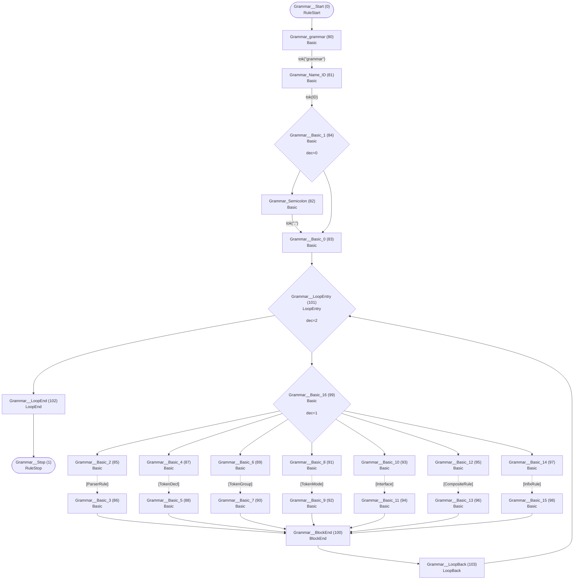

## Interface

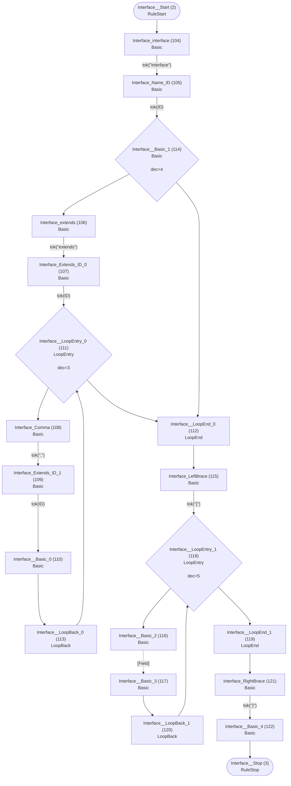

## Field

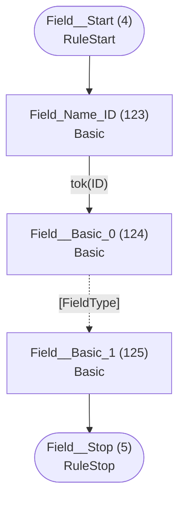

## FieldType

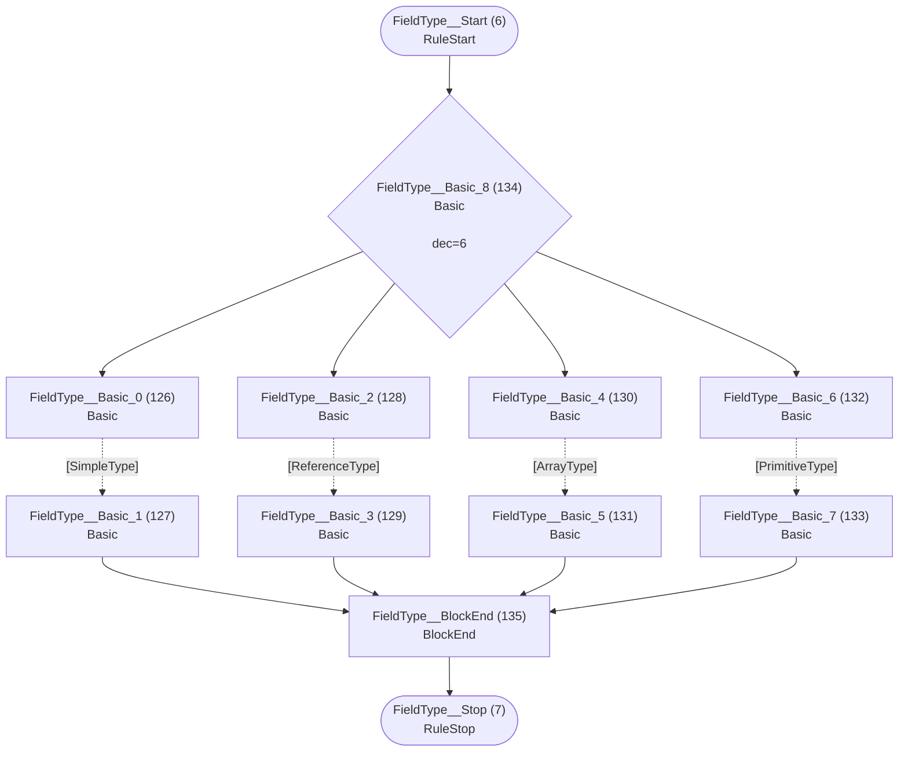

## ArrayType

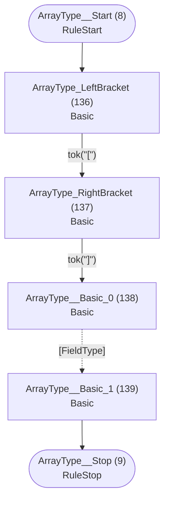

## ReferenceType

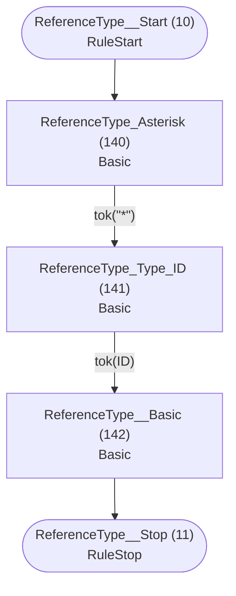

## SimpleType

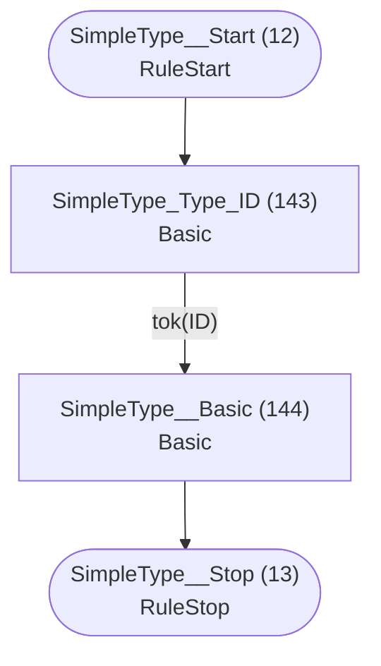

## PrimitiveType

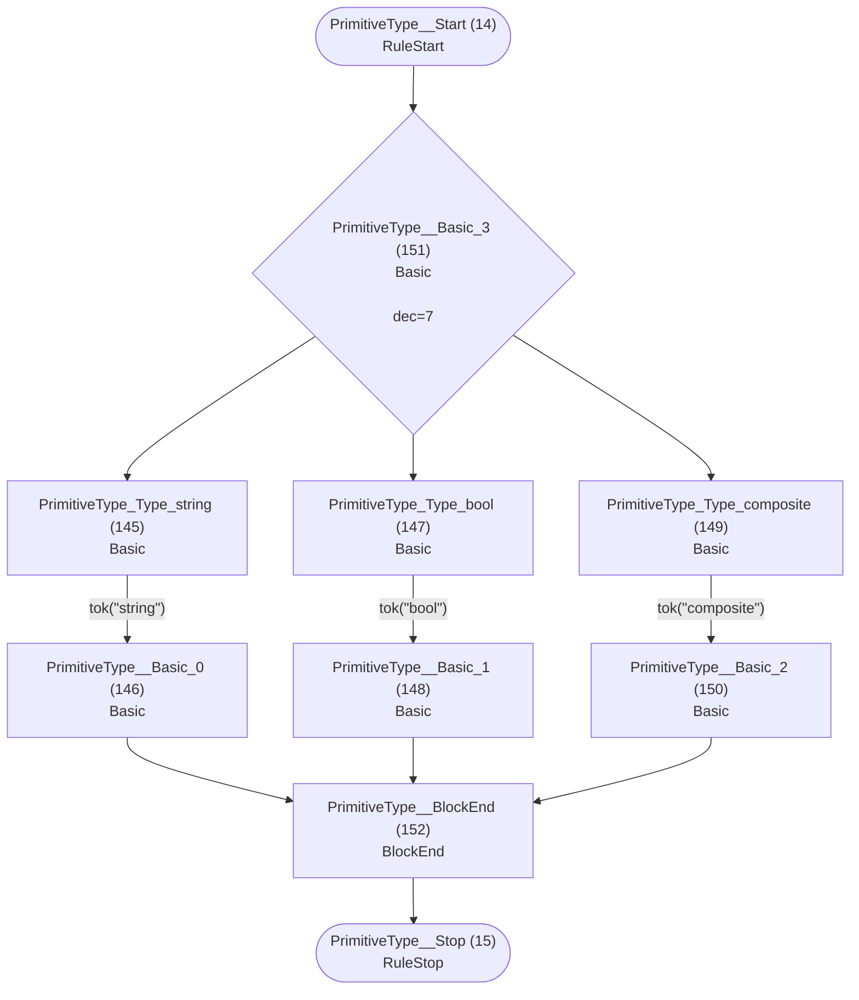

## ParserRule

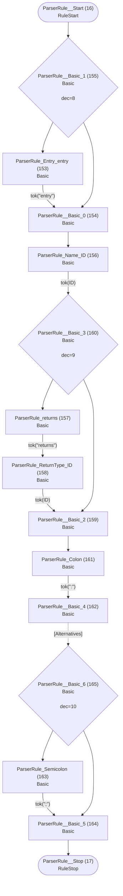

## TokenDecl

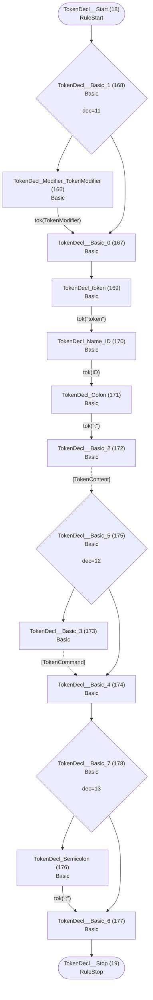

## TokenContent

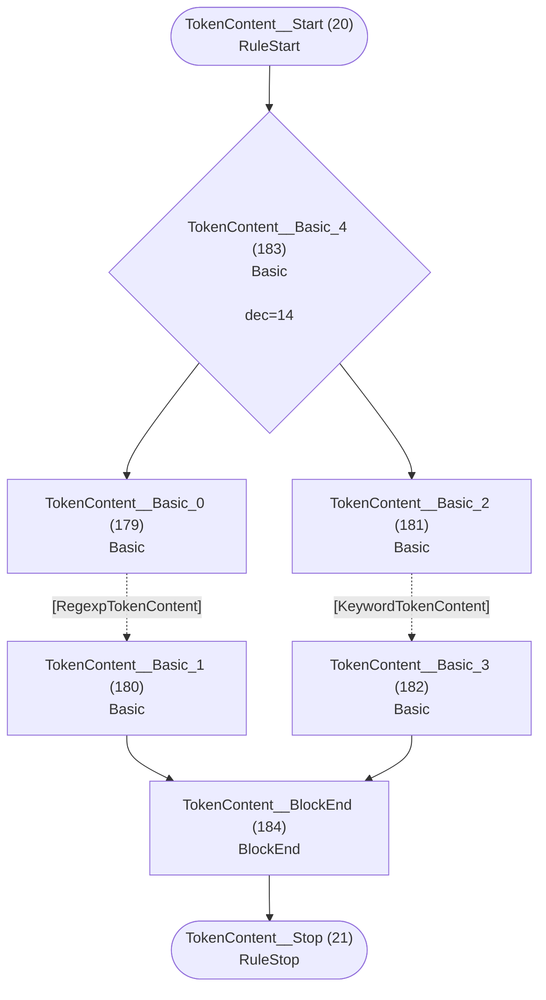

## RegexpTokenContent

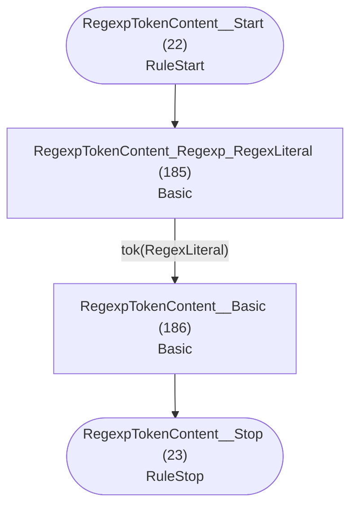

## KeywordTokenContent

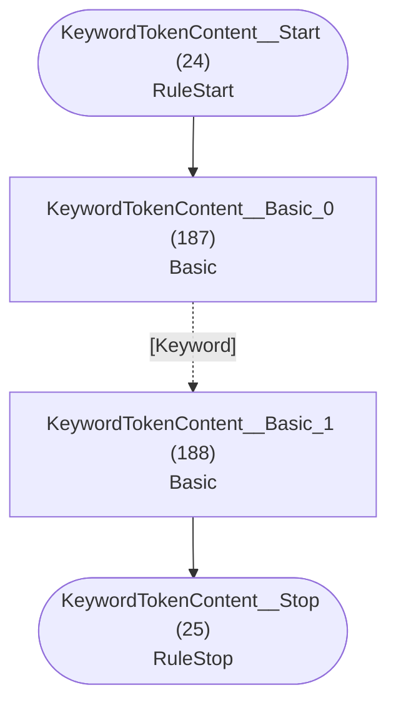

## TokenCommand

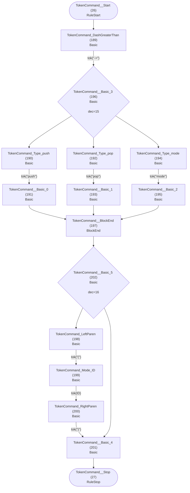

## TokenGroup

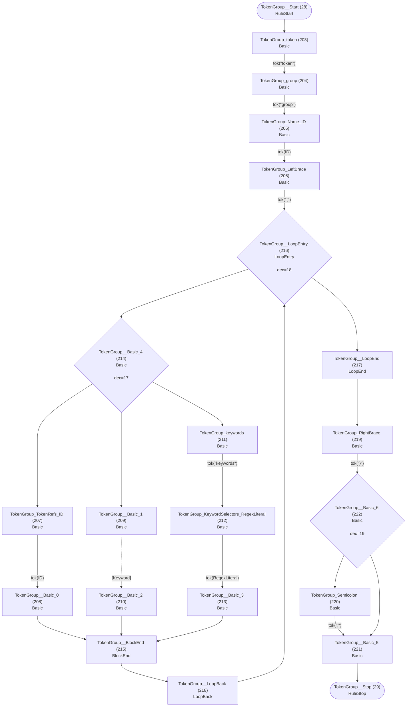

## TokenMode

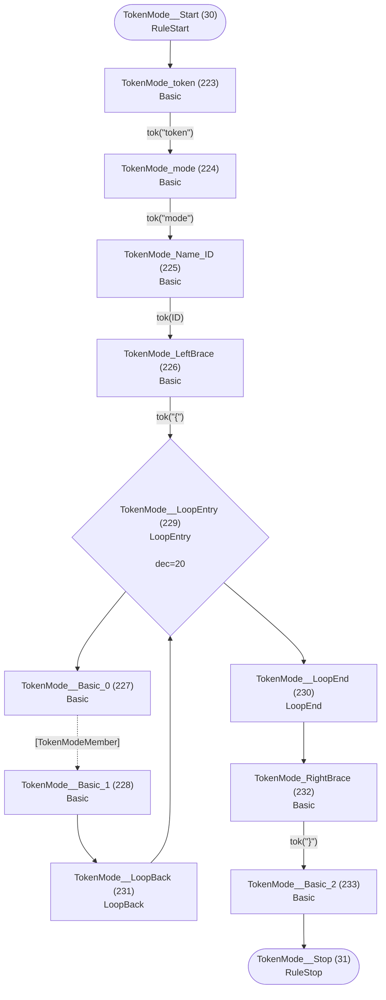

## TokenModeMember

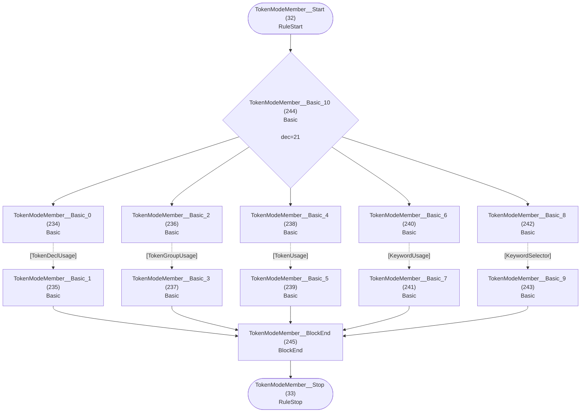

## TokenDeclUsage

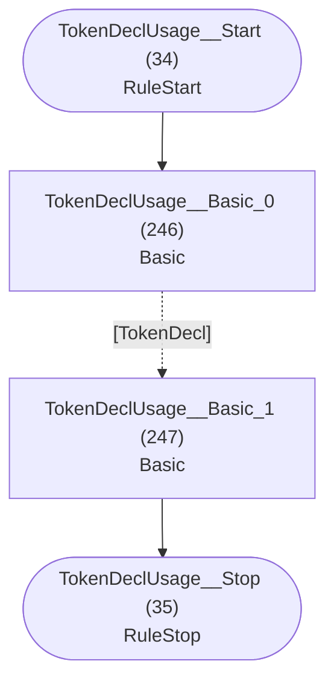

## TokenGroupUsage

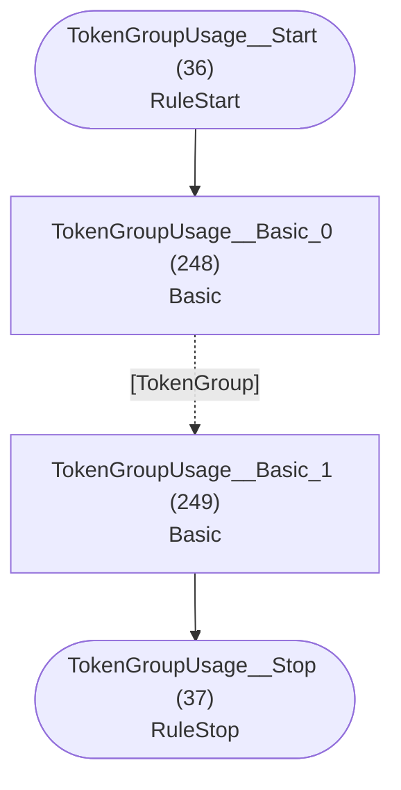

## TokenUsage

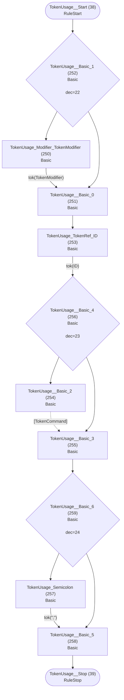

## KeywordUsage

```mermaid
flowchart TD
    q40(["KeywordUsage__Start (40)<br/>RuleStart"])
    q41(["KeywordUsage__Stop (41)<br/>RuleStop"])
    q260["KeywordUsage_Modifier_TokenModifier (260)<br/>Basic<br/>"]
    q261["KeywordUsage__Basic_0 (261)<br/>Basic<br/>"]
    q262{"KeywordUsage__Basic_1 (262)<br/>Basic<br/><br/>dec=25"}
    q263["KeywordUsage__Basic_2 (263)<br/>Basic<br/>"]
    q264["KeywordUsage__Basic_3 (264)<br/>Basic<br/>"]
    q265["KeywordUsage__Basic_4 (265)<br/>Basic<br/>"]
    q266{"KeywordUsage__Basic_5 (266)<br/>Basic<br/><br/>dec=26"}
    q267["KeywordUsage_Semicolon (267)<br/>Basic<br/>"]
    q268["KeywordUsage__Basic_6 (268)<br/>Basic<br/>"]
    q269{"KeywordUsage__Basic_7 (269)<br/>Basic<br/><br/>dec=27"}

    q40 --> q262
    q260 -->|"tok(TokenModifier)"| q261
    q261 --> q263
    q262 --> q260
    q262 --> q261
    q263 -.->|"[Keyword]"| q266
    q264 -.->|"[TokenCommand]"| q265
    q265 --> q269
    q266 --> q264
    q266 --> q265
    q267 -->|"tok(&quot;;&quot;)"| q268
    q268 --> q41
    q269 --> q267
    q269 --> q268
```

## KeywordSelector

```mermaid
flowchart TD
    q42(["KeywordSelector__Start (42)<br/>RuleStart"])
    q43(["KeywordSelector__Stop (43)<br/>RuleStop"])
    q270["KeywordSelector_keywords (270)<br/>Basic<br/>"]
    q271["KeywordSelector_Selector_RegexLiteral (271)<br/>Basic<br/>"]
    q272["KeywordSelector_Semicolon (272)<br/>Basic<br/>"]
    q273["KeywordSelector__Basic_0 (273)<br/>Basic<br/>"]
    q274{"KeywordSelector__Basic_1 (274)<br/>Basic<br/><br/>dec=28"}

    q42 --> q270
    q270 -->|"tok(&quot;keywords&quot;)"| q271
    q271 -->|"tok(RegexLiteral)"| q274
    q272 -->|"tok(&quot;;&quot;)"| q273
    q273 --> q43
    q274 --> q272
    q274 --> q273
```

## Alternatives

```mermaid
flowchart TD
    q44(["Alternatives__Start (44)<br/>RuleStart"])
    q45(["Alternatives__Stop (45)<br/>RuleStop"])
    q275["Alternatives__Basic_0 (275)<br/>Basic<br/>"]
    q276["Alternatives_Pipe (276)<br/>Basic<br/>"]
    q277["Alternatives__Basic_1 (277)<br/>Basic<br/>"]
    q278["Alternatives__Basic_2 (278)<br/>Basic<br/>"]
    q279{"Alternatives__LoopBack (279)<br/>LoopBack<br/><br/>dec=29"}
    q280["Alternatives__LoopEnd (280)<br/>LoopEnd<br/>"]
    q281{"Alternatives__Basic_3 (281)<br/>Basic<br/><br/>dec=30"}

    q44 --> q275
    q275 -.->|"[Group]"| q281
    q276 -->|"tok(&quot;|&quot;)"| q277
    q277 -.->|"[Group]"| q278
    q278 --> q279
    q279 --> q276
    q279 --> q280
    q280 --> q45
    q281 --> q276
    q281 --> q280
```

## Group

```mermaid
flowchart TD
    q46(["Group__Start (46)<br/>RuleStart"])
    q47(["Group__Stop (47)<br/>RuleStop"])
    q282["Group__Basic_0 (282)<br/>Basic<br/>"]
    q283["Group__Basic_1 (283)<br/>Basic<br/>"]
    q284["Group__Basic_2 (284)<br/>Basic<br/>"]
    q285{"Group__LoopBack (285)<br/>LoopBack<br/><br/>dec=31"}
    q286["Group__LoopEnd (286)<br/>LoopEnd<br/>"]
    q287{"Group__Basic_3 (287)<br/>Basic<br/><br/>dec=32"}

    q46 --> q282
    q282 -.->|"[Element]"| q287
    q283 -.->|"[Element]"| q284
    q284 --> q285
    q285 --> q283
    q285 --> q286
    q286 --> q47
    q287 --> q283
    q287 --> q286
```

## Element

```mermaid
flowchart TD
    q48(["Element__Start (48)<br/>RuleStart"])
    q49(["Element__Stop (49)<br/>RuleStop"])
    q288["Element__Basic_0 (288)<br/>Basic<br/>"]
    q289["Element__Basic_1 (289)<br/>Basic<br/>"]
    q290["Element__Basic_2 (290)<br/>Basic<br/>"]
    q291["Element__Basic_3 (291)<br/>Basic<br/>"]
    q292["Element__Basic_4 (292)<br/>Basic<br/>"]
    q293["Element__Basic_5 (293)<br/>Basic<br/>"]
    q294["Element__Basic_6 (294)<br/>Basic<br/>"]
    q295["Element__Basic_7 (295)<br/>Basic<br/>"]
    q296["Element_LeftParen (296)<br/>Basic<br/>"]
    q297["Element__Basic_8 (297)<br/>Basic<br/>"]
    q298["Element_RightParen (298)<br/>Basic<br/>"]
    q299["Element__Basic_9 (299)<br/>Basic<br/>"]
    q300{"Element__Basic_10 (300)<br/>Basic<br/><br/>dec=33"}
    q301["Element__BlockEnd (301)<br/>BlockEnd<br/>"]
    q302["Element_Cardinality_Cardinality (302)<br/>Basic<br/>"]
    q303["Element__Basic_11 (303)<br/>Basic<br/>"]
    q304{"Element__Basic_12 (304)<br/>Basic<br/><br/>dec=34"}

    q48 --> q300
    q288 -.->|"[Keyword]"| q289
    q289 --> q301
    q290 -.->|"[Assignment]"| q291
    q291 --> q301
    q292 -.->|"[RuleCall]"| q293
    q293 --> q301
    q294 -.->|"[Action]"| q295
    q295 --> q301
    q296 -->|"tok(&quot;(&quot;)"| q297
    q297 -.->|"[Alternatives]"| q298
    q298 -->|"tok(&quot;)&quot;)"| q299
    q299 --> q301
    q300 --> q288
    q300 --> q290
    q300 --> q292
    q300 --> q294
    q300 --> q296
    q301 --> q304
    q302 -->|"tok(Cardinality)"| q303
    q303 --> q49
    q304 --> q302
    q304 --> q303
```

## Keyword

```mermaid
flowchart TD
    q50(["Keyword__Start (50)<br/>RuleStart"])
    q51(["Keyword__Stop (51)<br/>RuleStop"])
    q305["Keyword_Value_StringLiteral (305)<br/>Basic<br/>"]
    q306["Keyword__Basic (306)<br/>Basic<br/>"]

    q50 --> q305
    q305 -->|"tok(StringLiteral)"| q306
    q306 --> q51
```

## Assignment

```mermaid
flowchart TD
    q52(["Assignment__Start (52)<br/>RuleStart"])
    q53(["Assignment__Stop (53)<br/>RuleStop"])
    q307["Assignment_Property_ID (307)<br/>Basic<br/>"]
    q308["Assignment_Operator_PlusEquals (308)<br/>Basic<br/>"]
    q309["Assignment__Basic_0 (309)<br/>Basic<br/>"]
    q310["Assignment_Operator_Equals (310)<br/>Basic<br/>"]
    q311["Assignment__Basic_1 (311)<br/>Basic<br/>"]
    q312["Assignment_Operator_QuestionEquals (312)<br/>Basic<br/>"]
    q313["Assignment__Basic_2 (313)<br/>Basic<br/>"]
    q314{"Assignment__Basic_3 (314)<br/>Basic<br/><br/>dec=35"}
    q315["Assignment__BlockEnd (315)<br/>BlockEnd<br/>"]
    q316["Assignment__Basic_4 (316)<br/>Basic<br/>"]
    q317["Assignment__Basic_5 (317)<br/>Basic<br/>"]

    q52 --> q307
    q307 -->|"tok(ID)"| q314
    q308 -->|"tok(&quot;+=&quot;)"| q309
    q309 --> q315
    q310 -->|"tok(&quot;=&quot;)"| q311
    q311 --> q315
    q312 -->|"tok(&quot;?=&quot;)"| q313
    q313 --> q315
    q314 --> q308
    q314 --> q310
    q314 --> q312
    q315 --> q316
    q316 -.->|"[Assignable]"| q317
    q317 --> q53
```

## Assignable

```mermaid
flowchart TD
    q54(["Assignable__Start (54)<br/>RuleStart"])
    q55(["Assignable__Stop (55)<br/>RuleStop"])
    q318["Assignable__Basic_0 (318)<br/>Basic<br/>"]
    q319["Assignable__Basic_1 (319)<br/>Basic<br/>"]
    q320["Assignable__Basic_2 (320)<br/>Basic<br/>"]
    q321["Assignable__Basic_3 (321)<br/>Basic<br/>"]
    q322["Assignable__Basic_4 (322)<br/>Basic<br/>"]
    q323["Assignable__Basic_5 (323)<br/>Basic<br/>"]
    q324["Assignable_LeftParen (324)<br/>Basic<br/>"]
    q325["Assignable__Basic_6 (325)<br/>Basic<br/>"]
    q326["Assignable_RightParen (326)<br/>Basic<br/>"]
    q327["Assignable__Basic_7 (327)<br/>Basic<br/>"]
    q328{"Assignable__Basic_8 (328)<br/>Basic<br/><br/>dec=36"}
    q329["Assignable__BlockEnd (329)<br/>BlockEnd<br/>"]

    q54 --> q328
    q318 -.->|"[Keyword]"| q319
    q319 --> q329
    q320 -.->|"[RuleCall]"| q321
    q321 --> q329
    q322 -.->|"[CrossRef]"| q323
    q323 --> q329
    q324 -->|"tok(&quot;(&quot;)"| q325
    q325 -.->|"[AssignableAlternatives]"| q326
    q326 -->|"tok(&quot;)&quot;)"| q327
    q327 --> q329
    q328 --> q318
    q328 --> q320
    q328 --> q322
    q328 --> q324
    q329 --> q55
```

## AssignableWithoutAlts

```mermaid
flowchart TD
    q56(["AssignableWithoutAlts__Start (56)<br/>RuleStart"])
    q57(["AssignableWithoutAlts__Stop (57)<br/>RuleStop"])
    q330["AssignableWithoutAlts__Basic_0 (330)<br/>Basic<br/>"]
    q331["AssignableWithoutAlts__Basic_1 (331)<br/>Basic<br/>"]
    q332["AssignableWithoutAlts__Basic_2 (332)<br/>Basic<br/>"]
    q333["AssignableWithoutAlts__Basic_3 (333)<br/>Basic<br/>"]
    q334["AssignableWithoutAlts__Basic_4 (334)<br/>Basic<br/>"]
    q335["AssignableWithoutAlts__Basic_5 (335)<br/>Basic<br/>"]
    q336{"AssignableWithoutAlts__Basic_6 (336)<br/>Basic<br/><br/>dec=37"}
    q337["AssignableWithoutAlts__BlockEnd (337)<br/>BlockEnd<br/>"]

    q56 --> q336
    q330 -.->|"[Keyword]"| q331
    q331 --> q337
    q332 -.->|"[RuleCall]"| q333
    q333 --> q337
    q334 -.->|"[CrossRef]"| q335
    q335 --> q337
    q336 --> q330
    q336 --> q332
    q336 --> q334
    q337 --> q57
```

## AssignableAlternatives

```mermaid
flowchart TD
    q58(["AssignableAlternatives__Start (58)<br/>RuleStart"])
    q59(["AssignableAlternatives__Stop (59)<br/>RuleStop"])
    q338["AssignableAlternatives__Basic_0 (338)<br/>Basic<br/>"]
    q339["AssignableAlternatives_Pipe (339)<br/>Basic<br/>"]
    q340["AssignableAlternatives__Basic_1 (340)<br/>Basic<br/>"]
    q341["AssignableAlternatives__Basic_2 (341)<br/>Basic<br/>"]
    q342{"AssignableAlternatives__LoopBack (342)<br/>LoopBack<br/><br/>dec=38"}
    q343["AssignableAlternatives__LoopEnd (343)<br/>LoopEnd<br/>"]
    q344{"AssignableAlternatives__Basic_3 (344)<br/>Basic<br/><br/>dec=39"}

    q58 --> q338
    q338 -.->|"[AssignableWithoutAlts]"| q344
    q339 -->|"tok(&quot;|&quot;)"| q340
    q340 -.->|"[AssignableWithoutAlts]"| q341
    q341 --> q342
    q342 --> q339
    q342 --> q343
    q343 --> q59
    q344 --> q339
    q344 --> q343
```

## CrossRef

```mermaid
flowchart TD
    q60(["CrossRef__Start (60)<br/>RuleStart"])
    q61(["CrossRef__Stop (61)<br/>RuleStop"])
    q345["CrossRef_LeftBracket (345)<br/>Basic<br/>"]
    q346["CrossRef_Type_ID (346)<br/>Basic<br/>"]
    q347["CrossRef_Colon (347)<br/>Basic<br/>"]
    q348["CrossRef__Basic_0 (348)<br/>Basic<br/>"]
    q349["CrossRef__Basic_1 (349)<br/>Basic<br/>"]
    q350{"CrossRef__Basic_2 (350)<br/>Basic<br/><br/>dec=40"}
    q351["CrossRef_RightBracket (351)<br/>Basic<br/>"]
    q352["CrossRef__Basic_3 (352)<br/>Basic<br/>"]

    q60 --> q345
    q345 -->|"tok(&quot;[&quot;)"| q346
    q346 -->|"tok(ID)"| q350
    q347 -->|"tok(&quot;:&quot;)"| q348
    q348 -.->|"[RuleCall]"| q349
    q349 --> q351
    q350 --> q347
    q350 --> q349
    q351 -->|"tok(&quot;]&quot;)"| q352
    q352 --> q61
```

## RuleCall

```mermaid
flowchart TD
    q62(["RuleCall__Start (62)<br/>RuleStart"])
    q63(["RuleCall__Stop (63)<br/>RuleStop"])
    q353["RuleCall_Rule_ID (353)<br/>Basic<br/>"]
    q354["RuleCall__Basic (354)<br/>Basic<br/>"]

    q62 --> q353
    q353 -->|"tok(ID)"| q354
    q354 --> q63
```

## Action

```mermaid
flowchart TD
    q64(["Action__Start (64)<br/>RuleStart"])
    q65(["Action__Stop (65)<br/>RuleStop"])
    q355["Action_LeftBrace (355)<br/>Basic<br/>"]
    q356["Action_Type_ID (356)<br/>Basic<br/>"]
    q357["Action_Dot (357)<br/>Basic<br/>"]
    q358["Action_Property_ID (358)<br/>Basic<br/>"]
    q359["Action_Operator_PlusEquals (359)<br/>Basic<br/>"]
    q360["Action__Basic_0 (360)<br/>Basic<br/>"]
    q361["Action_Operator_Equals (361)<br/>Basic<br/>"]
    q362["Action__Basic_1 (362)<br/>Basic<br/>"]
    q363{"Action__Basic_2 (363)<br/>Basic<br/><br/>dec=41"}
    q364["Action__BlockEnd (364)<br/>BlockEnd<br/>"]
    q365["Action_current (365)<br/>Basic<br/>"]
    q366["Action__Basic_3 (366)<br/>Basic<br/>"]
    q367{"Action__Basic_4 (367)<br/>Basic<br/><br/>dec=42"}
    q368["Action_RightBrace (368)<br/>Basic<br/>"]
    q369["Action__Basic_5 (369)<br/>Basic<br/>"]

    q64 --> q355
    q355 -->|"tok(&quot;{&quot;)"| q356
    q356 -->|"tok(ID)"| q367
    q357 -->|"tok(&quot;.&quot;)"| q358
    q358 -->|"tok(ID)"| q363
    q359 -->|"tok(&quot;+=&quot;)"| q360
    q360 --> q364
    q361 -->|"tok(&quot;=&quot;)"| q362
    q362 --> q364
    q363 --> q359
    q363 --> q361
    q364 --> q365
    q365 -->|"tok(&quot;current&quot;)"| q366
    q366 --> q368
    q367 --> q357
    q367 --> q366
    q368 -->|"tok(&quot;}&quot;)"| q369
    q369 --> q65
```

## CompositeRule

```mermaid
flowchart TD
    q66(["CompositeRule__Start (66)<br/>RuleStart"])
    q67(["CompositeRule__Stop (67)<br/>RuleStop"])
    q370["CompositeRule_composite (370)<br/>Basic<br/>"]
    q371["CompositeRule_Name_ID (371)<br/>Basic<br/>"]
    q372["CompositeRule_Colon (372)<br/>Basic<br/>"]
    q373["CompositeRule__Basic_0 (373)<br/>Basic<br/>"]
    q374["CompositeRule_Semicolon (374)<br/>Basic<br/>"]
    q375["CompositeRule__Basic_1 (375)<br/>Basic<br/>"]
    q376{"CompositeRule__Basic_2 (376)<br/>Basic<br/><br/>dec=43"}

    q66 --> q370
    q370 -->|"tok(&quot;composite&quot;)"| q371
    q371 -->|"tok(ID)"| q372
    q372 -->|"tok(&quot;:&quot;)"| q373
    q373 -.->|"[CompositeAlternatives]"| q376
    q374 -->|"tok(&quot;;&quot;)"| q375
    q375 --> q67
    q376 --> q374
    q376 --> q375
```

## CompositeAlternatives

```mermaid
flowchart TD
    q68(["CompositeAlternatives__Start (68)<br/>RuleStart"])
    q69(["CompositeAlternatives__Stop (69)<br/>RuleStop"])
    q377["CompositeAlternatives__Basic_0 (377)<br/>Basic<br/>"]
    q378["CompositeAlternatives_Pipe (378)<br/>Basic<br/>"]
    q379["CompositeAlternatives__Basic_1 (379)<br/>Basic<br/>"]
    q380["CompositeAlternatives__Basic_2 (380)<br/>Basic<br/>"]
    q381{"CompositeAlternatives__LoopBack (381)<br/>LoopBack<br/><br/>dec=44"}
    q382["CompositeAlternatives__LoopEnd (382)<br/>LoopEnd<br/>"]
    q383{"CompositeAlternatives__Basic_3 (383)<br/>Basic<br/><br/>dec=45"}

    q68 --> q377
    q377 -.->|"[CompositeGroup]"| q383
    q378 -->|"tok(&quot;|&quot;)"| q379
    q379 -.->|"[CompositeGroup]"| q380
    q380 --> q381
    q381 --> q378
    q381 --> q382
    q382 --> q69
    q383 --> q378
    q383 --> q382
```

## CompositeGroup

```mermaid
flowchart TD
    q70(["CompositeGroup__Start (70)<br/>RuleStart"])
    q71(["CompositeGroup__Stop (71)<br/>RuleStop"])
    q384["CompositeGroup__Basic_0 (384)<br/>Basic<br/>"]
    q385["CompositeGroup__Basic_1 (385)<br/>Basic<br/>"]
    q386["CompositeGroup__Basic_2 (386)<br/>Basic<br/>"]
    q387{"CompositeGroup__LoopBack (387)<br/>LoopBack<br/><br/>dec=46"}
    q388["CompositeGroup__LoopEnd (388)<br/>LoopEnd<br/>"]
    q389{"CompositeGroup__Basic_3 (389)<br/>Basic<br/><br/>dec=47"}

    q70 --> q384
    q384 -.->|"[CompositeElement]"| q389
    q385 -.->|"[CompositeElement]"| q386
    q386 --> q387
    q387 --> q385
    q387 --> q388
    q388 --> q71
    q389 --> q385
    q389 --> q388
```

## CompositeElement

```mermaid
flowchart TD
    q72(["CompositeElement__Start (72)<br/>RuleStart"])
    q73(["CompositeElement__Stop (73)<br/>RuleStop"])
    q390["CompositeElement__Basic_0 (390)<br/>Basic<br/>"]
    q391["CompositeElement__Basic_1 (391)<br/>Basic<br/>"]
    q392["CompositeElement__Basic_2 (392)<br/>Basic<br/>"]
    q393["CompositeElement__Basic_3 (393)<br/>Basic<br/>"]
    q394["CompositeElement_LeftParen (394)<br/>Basic<br/>"]
    q395["CompositeElement__Basic_4 (395)<br/>Basic<br/>"]
    q396["CompositeElement_RightParen (396)<br/>Basic<br/>"]
    q397["CompositeElement__Basic_5 (397)<br/>Basic<br/>"]
    q398{"CompositeElement__Basic_6 (398)<br/>Basic<br/><br/>dec=48"}
    q399["CompositeElement__BlockEnd (399)<br/>BlockEnd<br/>"]
    q400["CompositeElement_Cardinality_Cardinality (400)<br/>Basic<br/>"]
    q401["CompositeElement__Basic_7 (401)<br/>Basic<br/>"]
    q402{"CompositeElement__Basic_8 (402)<br/>Basic<br/><br/>dec=49"}

    q72 --> q398
    q390 -.->|"[Keyword]"| q391
    q391 --> q399
    q392 -.->|"[RuleCall]"| q393
    q393 --> q399
    q394 -->|"tok(&quot;(&quot;)"| q395
    q395 -.->|"[CompositeAlternatives]"| q396
    q396 -->|"tok(&quot;)&quot;)"| q397
    q397 --> q399
    q398 --> q390
    q398 --> q392
    q398 --> q394
    q399 --> q402
    q400 -->|"tok(Cardinality)"| q401
    q401 --> q73
    q402 --> q400
    q402 --> q401
```

## InfixRule

```mermaid
flowchart TD
    q74(["InfixRule__Start (74)<br/>RuleStart"])
    q75(["InfixRule__Stop (75)<br/>RuleStop"])
    q403["InfixRule_infix (403)<br/>Basic<br/>"]
    q404["InfixRule_Name_ID (404)<br/>Basic<br/>"]
    q405["InfixRule_on (405)<br/>Basic<br/>"]
    q406["InfixRule__Basic_0 (406)<br/>Basic<br/>"]
    q407["InfixRule_returns (407)<br/>Basic<br/>"]
    q408["InfixRule_ReturnType_ID (408)<br/>Basic<br/>"]
    q409["InfixRule__Basic_1 (409)<br/>Basic<br/>"]
    q410{"InfixRule__Basic_2 (410)<br/>Basic<br/><br/>dec=50"}
    q411["InfixRule_Colon (411)<br/>Basic<br/>"]
    q412["InfixRule__Basic_3 (412)<br/>Basic<br/>"]
    q413["InfixRule_GreaterThan (413)<br/>Basic<br/>"]
    q414["InfixRule__Basic_4 (414)<br/>Basic<br/>"]
    q415["InfixRule__Basic_5 (415)<br/>Basic<br/>"]
    q416{"InfixRule__LoopEntry (416)<br/>LoopEntry<br/><br/>dec=51"}
    q417["InfixRule__LoopEnd (417)<br/>LoopEnd<br/>"]
    q418["InfixRule__LoopBack (418)<br/>LoopBack<br/>"]
    q419["InfixRule_Semicolon (419)<br/>Basic<br/>"]
    q420["InfixRule__Basic_6 (420)<br/>Basic<br/>"]
    q421{"InfixRule__Basic_7 (421)<br/>Basic<br/><br/>dec=52"}

    q74 --> q403
    q403 -->|"tok(&quot;infix&quot;)"| q404
    q404 -->|"tok(ID)"| q405
    q405 -->|"tok(&quot;on&quot;)"| q406
    q406 -.->|"[RuleCall]"| q410
    q407 -->|"tok(&quot;returns&quot;)"| q408
    q408 -->|"tok(ID)"| q409
    q409 --> q411
    q410 --> q407
    q410 --> q409
    q411 -->|"tok(&quot;:&quot;)"| q412
    q412 -.->|"[PrecedenceGroup]"| q416
    q413 -->|"tok(&quot;>&quot;)"| q414
    q414 -.->|"[PrecedenceGroup]"| q415
    q415 --> q418
    q416 --> q413
    q416 --> q417
    q417 --> q421
    q418 --> q416
    q419 -->|"tok(&quot;;&quot;)"| q420
    q420 --> q75
    q421 --> q419
    q421 --> q420
```

## PrecedenceGroup

```mermaid
flowchart TD
    q76(["PrecedenceGroup__Start (76)<br/>RuleStart"])
    q77(["PrecedenceGroup__Stop (77)<br/>RuleStop"])
    q422["PrecedenceGroup_Associativity_left (422)<br/>Basic<br/>"]
    q423["PrecedenceGroup__Basic_0 (423)<br/>Basic<br/>"]
    q424["PrecedenceGroup_Associativity_right (424)<br/>Basic<br/>"]
    q425["PrecedenceGroup__Basic_1 (425)<br/>Basic<br/>"]
    q426{"PrecedenceGroup__Basic_2 (426)<br/>Basic<br/><br/>dec=53"}
    q427["PrecedenceGroup__BlockEnd (427)<br/>BlockEnd<br/>"]
    q428{"PrecedenceGroup__Basic_3 (428)<br/>Basic<br/><br/>dec=54"}
    q429["PrecedenceGroup__Basic_4 (429)<br/>Basic<br/>"]
    q430["PrecedenceGroup_Pipe (430)<br/>Basic<br/>"]
    q431["PrecedenceGroup__Basic_5 (431)<br/>Basic<br/>"]
    q432["PrecedenceGroup__Basic_6 (432)<br/>Basic<br/>"]
    q433{"PrecedenceGroup__LoopEntry (433)<br/>LoopEntry<br/><br/>dec=55"}
    q434["PrecedenceGroup__LoopEnd (434)<br/>LoopEnd<br/>"]
    q435["PrecedenceGroup__LoopBack (435)<br/>LoopBack<br/>"]

    q76 --> q428
    q422 -->|"tok(&quot;left&quot;)"| q423
    q423 --> q427
    q424 -->|"tok(&quot;right&quot;)"| q425
    q425 --> q427
    q426 --> q422
    q426 --> q424
    q427 --> q429
    q428 --> q426
    q428 --> q427
    q429 -.->|"[InfixOperator]"| q433
    q430 -->|"tok(&quot;|&quot;)"| q431
    q431 -.->|"[InfixOperator]"| q432
    q432 --> q435
    q433 --> q430
    q433 --> q434
    q434 --> q77
    q435 --> q433
```

## InfixOperator

```mermaid
flowchart TD
    q78(["InfixOperator__Start (78)<br/>RuleStart"])
    q79(["InfixOperator__Stop (79)<br/>RuleStop"])
    q436["InfixOperator__Basic_0 (436)<br/>Basic<br/>"]
    q437["InfixOperator__Basic_1 (437)<br/>Basic<br/>"]
    q438["InfixOperator__Basic_2 (438)<br/>Basic<br/>"]
    q439["InfixOperator__Basic_3 (439)<br/>Basic<br/>"]
    q440{"InfixOperator__Basic_4 (440)<br/>Basic<br/><br/>dec=56"}
    q441["InfixOperator__BlockEnd (441)<br/>BlockEnd<br/>"]

    q78 --> q440
    q436 -.->|"[Keyword]"| q437
    q437 --> q441
    q438 -.->|"[RuleCall]"| q439
    q439 --> q441
    q440 --> q436
    q440 --> q438
    q441 --> q79
```

