# Runtime ATN for completion

## Root

```mermaid
flowchart TD
    q0(["Root__Start (0)<br/>RuleStart"])
    q1(["Root__Stop (1)<br/>RuleStop"])
    q92["Root__Basic_0 (92)<br/>Basic<br/>"]
    q93["Root__Basic_1 (93)<br/>Basic<br/>"]
    q94["Root__Basic_2 (94)<br/>Basic<br/>"]
    q95["Root__Basic_3 (95)<br/>Basic<br/>"]
    q96["Root__Basic_4 (96)<br/>Basic<br/>"]
    q97["Root__Basic_5 (97)<br/>Basic<br/>"]
    q98["Root__Basic_6 (98)<br/>Basic<br/>"]
    q99["Root__Basic_7 (99)<br/>Basic<br/>"]
    q100["Root__Basic_8 (100)<br/>Basic<br/>"]
    q101["Root__Basic_9 (101)<br/>Basic<br/>"]
    q102["Root__Basic_10 (102)<br/>Basic<br/>"]
    q103["Root__Basic_11 (103)<br/>Basic<br/>"]
    q104["Root__Basic_12 (104)<br/>Basic<br/>"]
    q105["Root__Basic_13 (105)<br/>Basic<br/>"]
    q106["Root__Basic_14 (106)<br/>Basic<br/>"]
    q107["Root__Basic_15 (107)<br/>Basic<br/>"]
    q108["Root__Basic_16 (108)<br/>Basic<br/>"]
    q109["Root__Basic_17 (109)<br/>Basic<br/>"]
    q110["Root__Basic_18 (110)<br/>Basic<br/>"]
    q111["Root__Basic_19 (111)<br/>Basic<br/>"]
    q112["Root__Basic_20 (112)<br/>Basic<br/>"]
    q113["Root__Basic_21 (113)<br/>Basic<br/>"]
    q114["Root__Basic_22 (114)<br/>Basic<br/>"]
    q115["Root__Basic_23 (115)<br/>Basic<br/>"]
    q116["Root__Basic_24 (116)<br/>Basic<br/>"]
    q117["Root__Basic_25 (117)<br/>Basic<br/>"]
    q118["Root__Basic_26 (118)<br/>Basic<br/>"]
    q119["Root__Basic_27 (119)<br/>Basic<br/>"]
    q120["Root__Basic_28 (120)<br/>Basic<br/>"]
    q121["Root__Basic_29 (121)<br/>Basic<br/>"]
    q122["Root__Basic_30 (122)<br/>Basic<br/>"]
    q123["Root__Basic_31 (123)<br/>Basic<br/>"]
    q124["Root__Basic_32 (124)<br/>Basic<br/>"]
    q125["Root__Basic_33 (125)<br/>Basic<br/>"]
    q126["Root__Basic_34 (126)<br/>Basic<br/>"]
    q127["Root__Basic_35 (127)<br/>Basic<br/>"]
    q128["Root__Basic_36 (128)<br/>Basic<br/>"]
    q129["Root__Basic_37 (129)<br/>Basic<br/>"]
    q130["Root__Basic_38 (130)<br/>Basic<br/>"]
    q131["Root__Basic_39 (131)<br/>Basic<br/>"]
    q132["Root__Basic_40 (132)<br/>Basic<br/>"]
    q133["Root__Basic_41 (133)<br/>Basic<br/>"]
    q134["Root__Basic_42 (134)<br/>Basic<br/>"]
    q135["Root__Basic_43 (135)<br/>Basic<br/>"]
    q136["Root__Basic_44 (136)<br/>Basic<br/>"]
    q137["Root__Basic_45 (137)<br/>Basic<br/>"]
    q138["Root__Basic_46 (138)<br/>Basic<br/>"]
    q139["Root__Basic_47 (139)<br/>Basic<br/>"]
    q140["Root__Basic_48 (140)<br/>Basic<br/>"]
    q141["Root__Basic_49 (141)<br/>Basic<br/>"]
    q142["Root__Basic_50 (142)<br/>Basic<br/>"]
    q143["Root__Basic_51 (143)<br/>Basic<br/>"]
    q144["Root__Basic_52 (144)<br/>Basic<br/>"]
    q145["Root__Basic_53 (145)<br/>Basic<br/>"]
    q146["Root__Basic_54 (146)<br/>Basic<br/>"]
    q147["Root__Basic_55 (147)<br/>Basic<br/>"]
    q148["Root__Basic_56 (148)<br/>Basic<br/>"]
    q149["Root__Basic_57 (149)<br/>Basic<br/>"]
    q150{"Root__Basic_58 (150)<br/>Basic<br/><br/>dec=0"}
    q151["Root__BlockEnd (151)<br/>BlockEnd<br/>"]
    q152{"Root__LoopEntry (152)<br/>LoopEntry<br/><br/>dec=1"}
    q153["Root__LoopEnd (153)<br/>LoopEnd<br/>"]
    q154["Root__LoopBack (154)<br/>LoopBack<br/>"]

    q0 --> q152
    q92 -.->|"[Declare]"| q93
    q93 --> q151
    q94 -.->|"[Seq]"| q95
    q95 --> q151
    q96 -.->|"[Alt]"| q97
    q97 --> q151
    q98 -.->|"[Prefix]"| q99
    q99 --> q151
    q100 -.->|"[Call]"| q101
    q101 --> q151
    q102 -.->|"[RefFQN]"| q103
    q103 --> q151
    q104 -.->|"[RefList]"| q105
    q105 --> q151
    q106 -.->|"[RefID]"| q107
    q107 --> q151
    q108 -.->|"[Member]"| q109
    q109 --> q151
    q110 -.->|"[MemberNoDot]"| q111
    q111 --> q151
    q112 -.->|"[RefOrKeyword]"| q113
    q113 --> q151
    q114 -.->|"[Dedup]"| q115
    q115 --> q151
    q116 -.->|"[Opt]"| q117
    q117 --> q151
    q118 -.->|"[Group]"| q119
    q119 --> q151
    q120 -.->|"[RefGroup]"| q121
    q121 --> q151
    q122 -.->|"[RefAction]"| q123
    q123 --> q151
    q124 -.->|"[Scope]"| q125
    q125 --> q151
    q126 -.->|"[Loop]"| q127
    q127 --> q151
    q128 -.->|"[Chain]"| q129
    q129 --> q151
    q130 -.->|"[Infix]"| q131
    q131 --> q151
    q132 -.->|"[Wrap]"| q133
    q133 --> q151
    q134 -.->|"[Shadow]"| q135
    q135 --> q151
    q136 -.->|"[Nest]"| q137
    q137 --> q151
    q138 -.->|"[Ambig]"| q139
    q139 --> q151
    q140 -.->|"[Deep]"| q141
    q141 --> q151
    q142 -.->|"[Retype]"| q143
    q143 --> q151
    q144 -.->|"[Dep]"| q145
    q145 --> q151
    q146 -.->|"[Act]"| q147
    q147 --> q151
    q148 -.->|"[Lead]"| q149
    q149 --> q151
    q150 --> q92
    q150 --> q94
    q150 --> q96
    q150 --> q98
    q150 --> q100
    q150 --> q102
    q150 --> q104
    q150 --> q106
    q150 --> q108
    q150 --> q110
    q150 --> q112
    q150 --> q114
    q150 --> q116
    q150 --> q118
    q150 --> q120
    q150 --> q122
    q150 --> q124
    q150 --> q126
    q150 --> q128
    q150 --> q130
    q150 --> q132
    q150 --> q134
    q150 --> q136
    q150 --> q138
    q150 --> q140
    q150 --> q142
    q150 --> q144
    q150 --> q146
    q150 --> q148
    q151 --> q154
    q152 --> q150
    q152 --> q153
    q153 --> q1
    q154 --> q152
```

## Declare

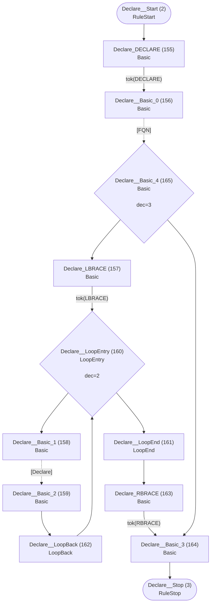

## Seq

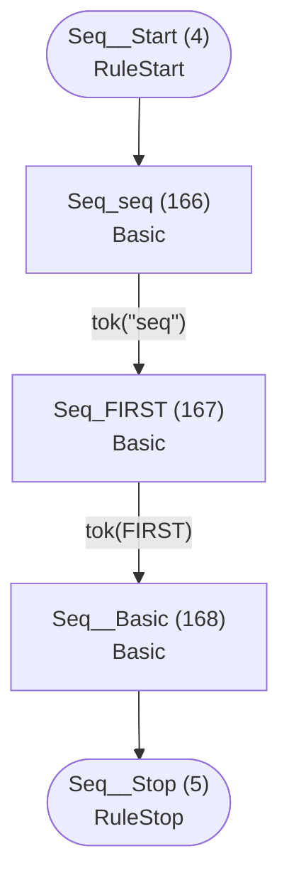

## Alt

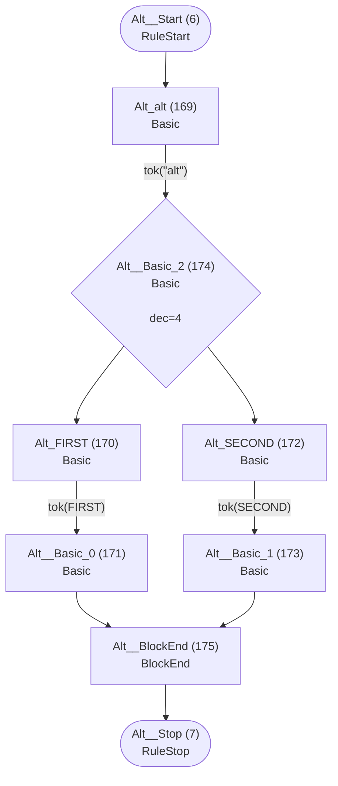

## Prefix

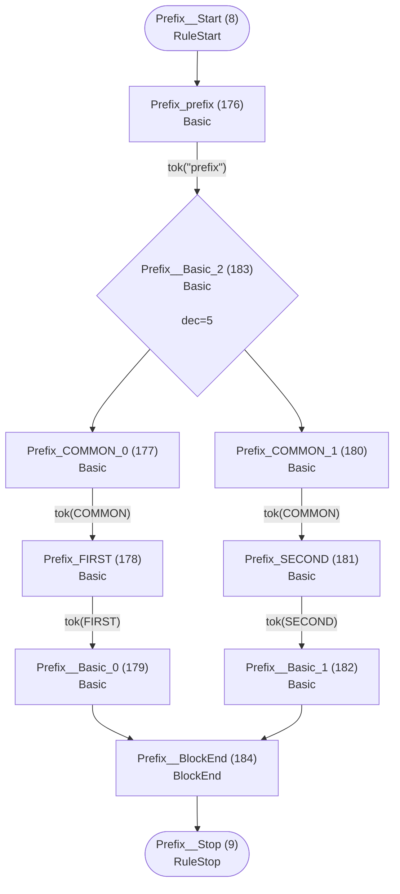

## Call

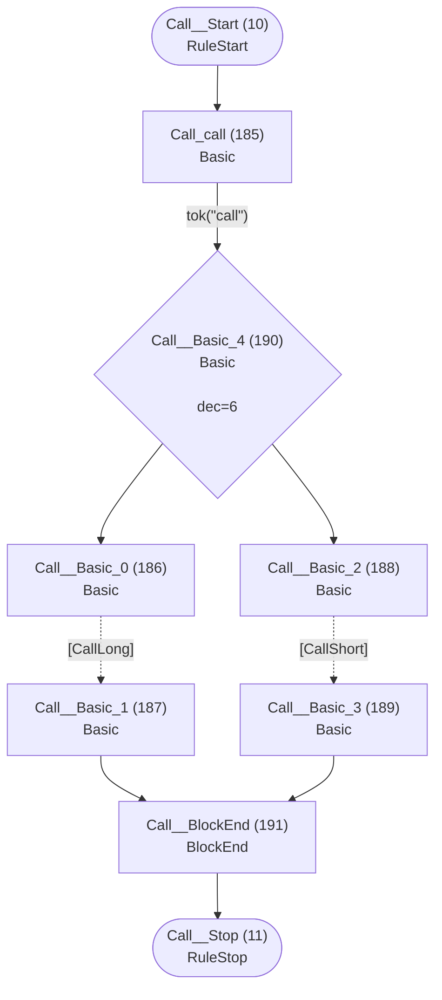

## CallLong

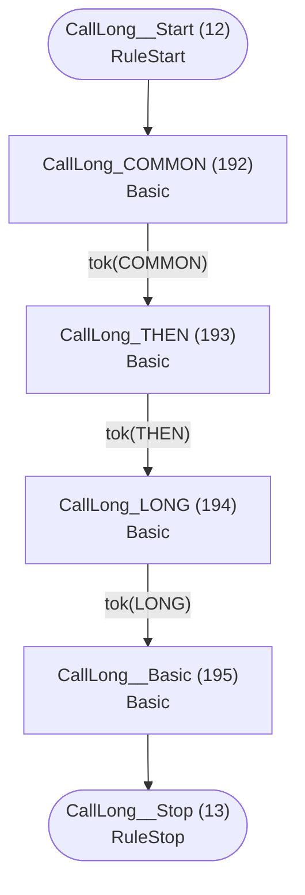

## CallShort

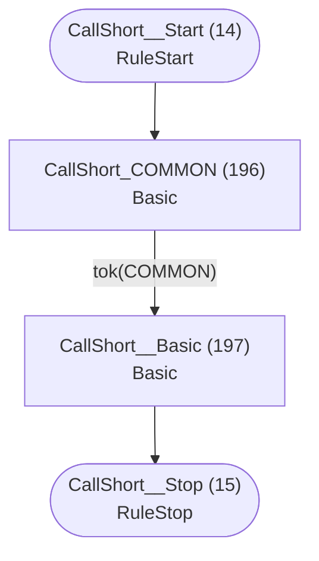

## RefFQN

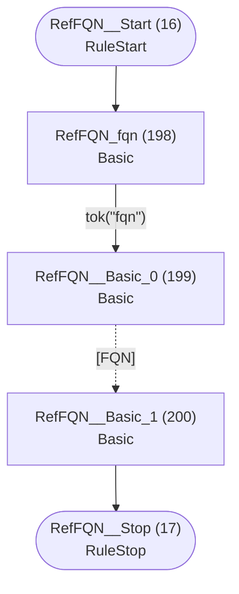

## RefList

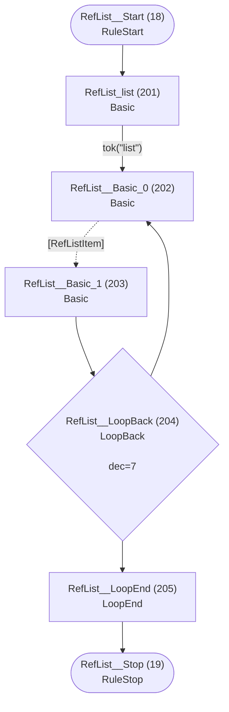

## RefListItem

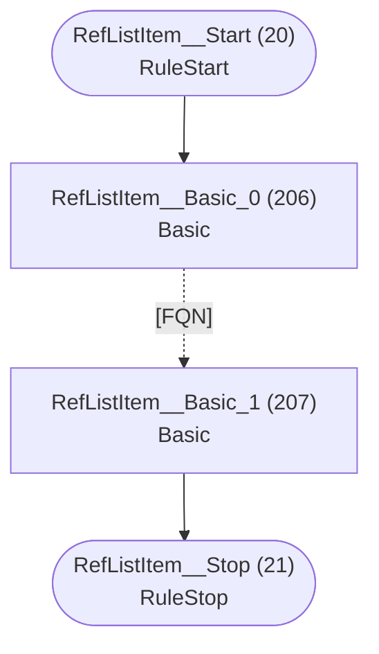

## RefID

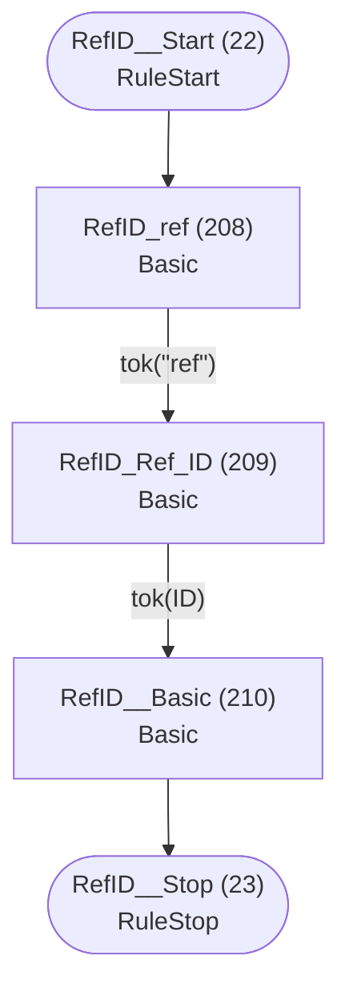

## Member

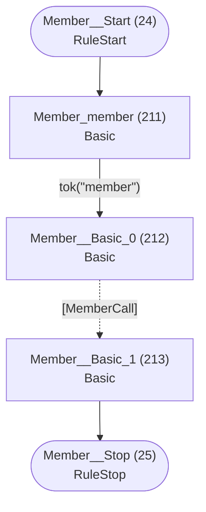

## MemberNoDot

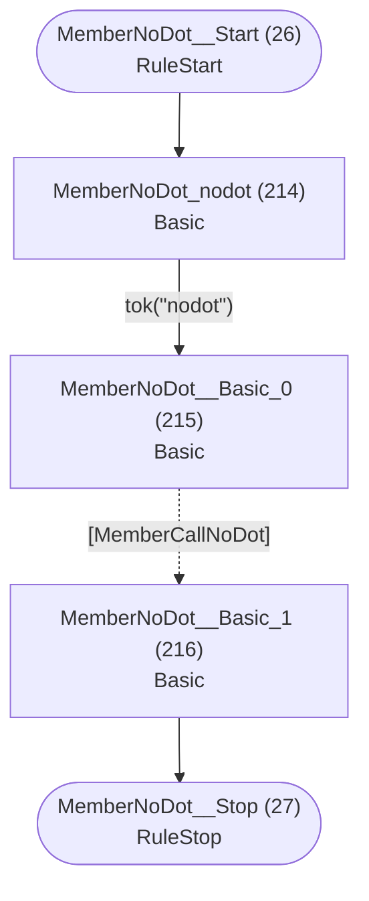

## MemberCall

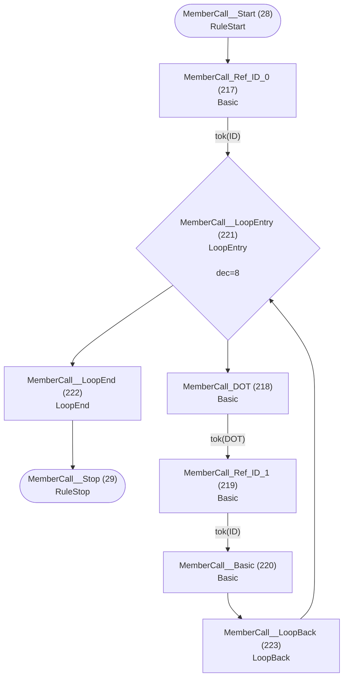

## MemberCallNoDot

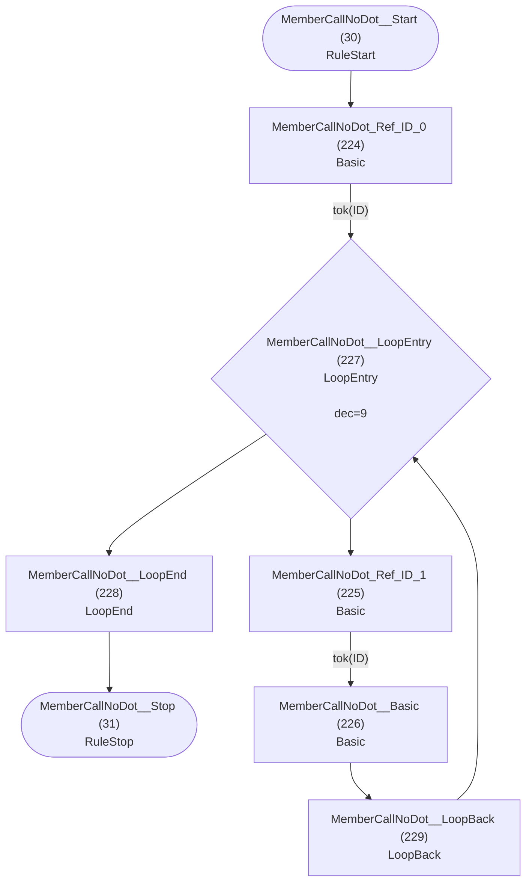

## RefOrKeyword

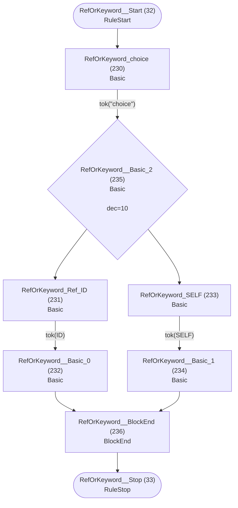

## Dedup

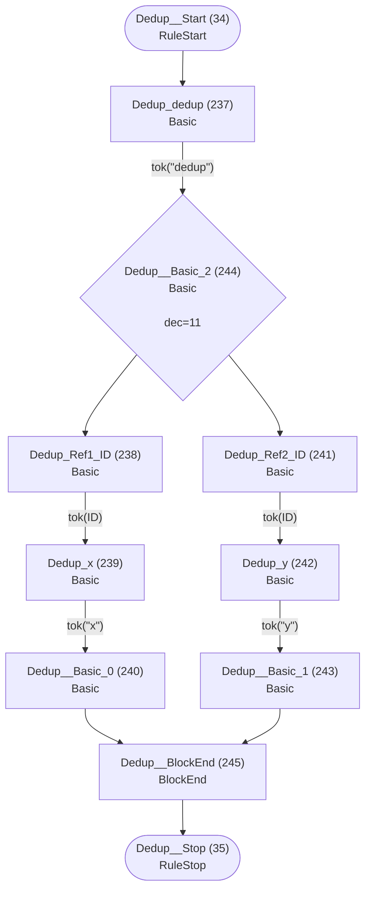

## Opt

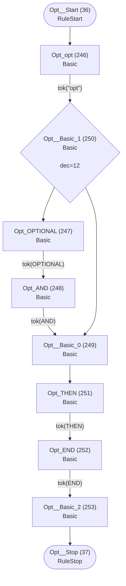

## Group

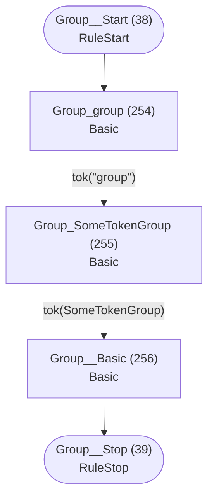

## RefGroup

```mermaid
flowchart TD
    q40(["RefGroup__Start (40)<br/>RuleStart"])
    q41(["RefGroup__Stop (41)<br/>RuleStop"])
    q257["RefGroup_refgroup (257)<br/>Basic<br/>"]
    q258["RefGroup_Ref_SomeTokenGroup (258)<br/>Basic<br/>"]
    q259["RefGroup__Basic (259)<br/>Basic<br/>"]

    q40 --> q257
    q257 -->|"tok(&quot;refgroup&quot;)"| q258
    q258 -->|"tok(SomeTokenGroup)"| q259
    q259 --> q41
```

## RefAction

```mermaid
flowchart TD
    q42(["RefAction__Start (42)<br/>RuleStart"])
    q43(["RefAction__Stop (43)<br/>RuleStop"])
    q260["RefAction_action (260)<br/>Basic<br/>"]
    q261["RefAction_Ref_ID (261)<br/>Basic<br/>"]
    q262["RefAction__Basic (262)<br/>Basic<br/>"]

    q42 --> q260
    q260 -->|"tok(&quot;action&quot;)"| q261
    q261 -->|"tok(ID)"| q262
    q262 --> q43
```

## Scope

```mermaid
flowchart TD
    q44(["Scope__Start (44)<br/>RuleStart"])
    q45(["Scope__Stop (45)<br/>RuleStop"])
    q263["Scope_scope (263)<br/>Basic<br/>"]
    q264["Scope_LBRACE (264)<br/>Basic<br/>"]
    q265["Scope__Basic_0 (265)<br/>Basic<br/>"]
    q266["Scope__Basic_1 (266)<br/>Basic<br/>"]
    q267{"Scope__LoopEntry_0 (267)<br/>LoopEntry<br/><br/>dec=13"}
    q268["Scope__LoopEnd_0 (268)<br/>LoopEnd<br/>"]
    q269["Scope__LoopBack_0 (269)<br/>LoopBack<br/>"]
    q270["Scope_use (270)<br/>Basic<br/>"]
    q271["Scope__Basic_2 (271)<br/>Basic<br/>"]
    q272["Scope_AND (272)<br/>Basic<br/>"]
    q273["Scope__Basic_3 (273)<br/>Basic<br/>"]
    q274["Scope__Basic_4 (274)<br/>Basic<br/>"]
    q275{"Scope__LoopEntry_1 (275)<br/>LoopEntry<br/><br/>dec=14"}
    q276["Scope__LoopEnd_1 (276)<br/>LoopEnd<br/>"]
    q277["Scope__LoopBack_1 (277)<br/>LoopBack<br/>"]
    q278["Scope_RBRACE (278)<br/>Basic<br/>"]
    q279["Scope__Basic_5 (279)<br/>Basic<br/>"]

    q44 --> q263
    q263 -->|"tok(&quot;scope&quot;)"| q264
    q264 -->|"tok(LBRACE)"| q267
    q265 -.->|"[Declare]"| q266
    q266 --> q269
    q267 --> q265
    q267 --> q268
    q268 --> q270
    q269 --> q267
    q270 -->|"tok(&quot;use&quot;)"| q271
    q271 -.->|"[RefItem]"| q275
    q272 -->|"tok(AND)"| q273
    q273 -.->|"[RefItem]"| q274
    q274 --> q277
    q275 --> q272
    q275 --> q276
    q276 --> q278
    q277 --> q275
    q278 -->|"tok(RBRACE)"| q279
    q279 --> q45
```

## RefItem

```mermaid
flowchart TD
    q46(["RefItem__Start (46)<br/>RuleStart"])
    q47(["RefItem__Stop (47)<br/>RuleStop"])
    q280["RefItem_Ref_ID (280)<br/>Basic<br/>"]
    q281["RefItem__Basic (281)<br/>Basic<br/>"]

    q46 --> q280
    q280 -->|"tok(ID)"| q281
    q281 --> q47
```

## Loop

```mermaid
flowchart TD
    q48(["Loop__Start (48)<br/>RuleStart"])
    q49(["Loop__Stop (49)<br/>RuleStop"])
    q282["Loop_loop (282)<br/>Basic<br/>"]
    q283["Loop_LBRACE (283)<br/>Basic<br/>"]
    q284["Loop__Basic_0 (284)<br/>Basic<br/>"]
    q285["Loop__Basic_1 (285)<br/>Basic<br/>"]
    q286["Loop__Basic_2 (286)<br/>Basic<br/>"]
    q287["Loop__Basic_3 (287)<br/>Basic<br/>"]
    q288["Loop__Basic_4 (288)<br/>Basic<br/>"]
    q289["Loop__Basic_5 (289)<br/>Basic<br/>"]
    q290{"Loop__Basic_6 (290)<br/>Basic<br/><br/>dec=15"}
    q291["Loop__BlockEnd (291)<br/>BlockEnd<br/>"]
    q292{"Loop__LoopEntry (292)<br/>LoopEntry<br/><br/>dec=16"}
    q293["Loop__LoopEnd (293)<br/>LoopEnd<br/>"]
    q294["Loop__LoopBack (294)<br/>LoopBack<br/>"]
    q295["Loop_RBRACE (295)<br/>Basic<br/>"]
    q296["Loop__Basic_7 (296)<br/>Basic<br/>"]

    q48 --> q282
    q282 -->|"tok(&quot;loop&quot;)"| q283
    q283 -->|"tok(LBRACE)"| q292
    q284 -.->|"[Declare]"| q285
    q285 --> q291
    q286 -.->|"[RefItem]"| q287
    q287 --> q291
    q288 -.->|"[Loop]"| q289
    q289 --> q291
    q290 --> q284
    q290 --> q286
    q290 --> q288
    q291 --> q294
    q292 --> q290
    q292 --> q293
    q293 --> q295
    q294 --> q292
    q295 -->|"tok(RBRACE)"| q296
    q296 --> q49
```

## Chain

```mermaid
flowchart TD
    q50(["Chain__Start (50)<br/>RuleStart"])
    q51(["Chain__Stop (51)<br/>RuleStop"])
    q297["Chain_chain (297)<br/>Basic<br/>"]
    q298["Chain_LBRACE (298)<br/>Basic<br/>"]
    q299["Chain__Basic_0 (299)<br/>Basic<br/>"]
    q300["Chain__Basic_1 (300)<br/>Basic<br/>"]
    q301{"Chain__LoopEntry (301)<br/>LoopEntry<br/><br/>dec=17"}
    q302["Chain__LoopEnd (302)<br/>LoopEnd<br/>"]
    q303["Chain__LoopBack (303)<br/>LoopBack<br/>"]
    q304["Chain_RBRACE (304)<br/>Basic<br/>"]
    q305["Chain__Basic_2 (305)<br/>Basic<br/>"]

    q50 --> q297
    q297 -->|"tok(&quot;chain&quot;)"| q298
    q298 -->|"tok(LBRACE)"| q301
    q299 -.->|"[ChainItem]"| q300
    q300 --> q303
    q301 --> q299
    q301 --> q302
    q302 --> q304
    q303 --> q301
    q304 -->|"tok(RBRACE)"| q305
    q305 --> q51
```

## ChainItem

```mermaid
flowchart TD
    q52(["ChainItem__Start (52)<br/>RuleStart"])
    q53(["ChainItem__Stop (53)<br/>RuleStop"])
    q306["ChainItem_Ref_ID_0 (306)<br/>Basic<br/>"]
    q307["ChainItem_AND (307)<br/>Basic<br/>"]
    q308["ChainItem_Ref_ID_1 (308)<br/>Basic<br/>"]
    q309["ChainItem__Basic (309)<br/>Basic<br/>"]
    q310{"ChainItem__LoopEntry (310)<br/>LoopEntry<br/><br/>dec=18"}
    q311["ChainItem__LoopEnd (311)<br/>LoopEnd<br/>"]
    q312["ChainItem__LoopBack (312)<br/>LoopBack<br/>"]

    q52 --> q306
    q306 -->|"tok(ID)"| q310
    q307 -->|"tok(AND)"| q308
    q308 -->|"tok(ID)"| q309
    q309 --> q312
    q310 --> q307
    q310 --> q311
    q311 --> q53
    q312 --> q310
```

## Infix

```mermaid
flowchart TD
    q54(["Infix__Start (54)<br/>RuleStart"])
    q55(["Infix__Stop (55)<br/>RuleStop"])
    q313["Infix_infix (313)<br/>Basic<br/>"]
    q314["Infix_LBRACE (314)<br/>Basic<br/>"]
    q315["Infix__Basic_0 (315)<br/>Basic<br/>"]
    q316["Infix__Basic_1 (316)<br/>Basic<br/>"]
    q317{"Infix__LoopEntry (317)<br/>LoopEntry<br/><br/>dec=19"}
    q318["Infix__LoopEnd (318)<br/>LoopEnd<br/>"]
    q319["Infix__LoopBack (319)<br/>LoopBack<br/>"]
    q320["Infix_RBRACE (320)<br/>Basic<br/>"]
    q321["Infix__Basic_2 (321)<br/>Basic<br/>"]

    q54 --> q313
    q313 -->|"tok(&quot;infix&quot;)"| q314
    q314 -->|"tok(LBRACE)"| q317
    q315 -.->|"[Binary]"| q316
    q316 --> q319
    q317 --> q315
    q317 --> q318
    q318 --> q320
    q319 --> q317
    q320 -->|"tok(RBRACE)"| q321
    q321 --> q55
```

## Primary

```mermaid
flowchart TD
    q56(["Primary__Start (56)<br/>RuleStart"])
    q57(["Primary__Stop (57)<br/>RuleStop"])
    q322["Primary_Ref_ID (322)<br/>Basic<br/>"]
    q323["Primary__Basic (323)<br/>Basic<br/>"]

    q56 --> q322
    q322 -->|"tok(ID)"| q323
    q323 --> q57
```

## Wrap

```mermaid
flowchart TD
    q58(["Wrap__Start (58)<br/>RuleStart"])
    q59(["Wrap__Stop (59)<br/>RuleStop"])
    q324["Wrap_wrap (324)<br/>Basic<br/>"]
    q325["Wrap_LBRACE (325)<br/>Basic<br/>"]
    q326["Wrap__Basic_0 (326)<br/>Basic<br/>"]
    q327["Wrap_RBRACE (327)<br/>Basic<br/>"]
    q328["Wrap__Basic_1 (328)<br/>Basic<br/>"]

    q58 --> q324
    q324 -->|"tok(&quot;wrap&quot;)"| q325
    q325 -->|"tok(LBRACE)"| q326
    q326 -.->|"[WrapGroup]"| q327
    q327 -->|"tok(RBRACE)"| q328
    q328 --> q59
```

## WrapGroup

```mermaid
flowchart TD
    q60(["WrapGroup__Start (60)<br/>RuleStart"])
    q61(["WrapGroup__Stop (61)<br/>RuleStop"])
    q329["WrapGroup__Basic_0 (329)<br/>Basic<br/>"]
    q330["WrapGroup__Basic_1 (330)<br/>Basic<br/>"]
    q331["WrapGroup__Basic_2 (331)<br/>Basic<br/>"]
    q332{"WrapGroup__LoopBack (332)<br/>LoopBack<br/><br/>dec=20"}
    q333["WrapGroup__LoopEnd (333)<br/>LoopEnd<br/>"]
    q334{"WrapGroup__Basic_3 (334)<br/>Basic<br/><br/>dec=21"}

    q60 --> q329
    q329 -.->|"[WrapElement]"| q334
    q330 -.->|"[WrapElement]"| q331
    q331 --> q332
    q332 --> q330
    q332 --> q333
    q333 --> q61
    q334 --> q330
    q334 --> q333
```

## WrapElement

```mermaid
flowchart TD
    q62(["WrapElement__Start (62)<br/>RuleStart"])
    q63(["WrapElement__Stop (63)<br/>RuleStop"])
    q335["WrapElement_Ref_ID (335)<br/>Basic<br/>"]
    q336["WrapElement__Basic_0 (336)<br/>Basic<br/>"]
    q337["WrapElement_LBRACE (337)<br/>Basic<br/>"]
    q338["WrapElement__Basic_1 (338)<br/>Basic<br/>"]
    q339["WrapElement_RBRACE (339)<br/>Basic<br/>"]
    q340["WrapElement__Basic_2 (340)<br/>Basic<br/>"]
    q341{"WrapElement__Basic_3 (341)<br/>Basic<br/><br/>dec=22"}
    q342["WrapElement__BlockEnd (342)<br/>BlockEnd<br/>"]

    q62 --> q341
    q335 -->|"tok(ID)"| q336
    q336 --> q342
    q337 -->|"tok(LBRACE)"| q338
    q338 -.->|"[WrapGroup]"| q339
    q339 -->|"tok(RBRACE)"| q340
    q340 --> q342
    q341 --> q335
    q341 --> q337
    q342 --> q63
```

## Shadow

```mermaid
flowchart TD
    q64(["Shadow__Start (64)<br/>RuleStart"])
    q65(["Shadow__Stop (65)<br/>RuleStop"])
    q343["Shadow_shadow (343)<br/>Basic<br/>"]
    q344["Shadow__Basic_0 (344)<br/>Basic<br/>"]
    q345["Shadow__Basic_1 (345)<br/>Basic<br/>"]
    q346["Shadow__Basic_2 (346)<br/>Basic<br/>"]
    q347{"Shadow__LoopEntry (347)<br/>LoopEntry<br/><br/>dec=23"}
    q348["Shadow__LoopEnd (348)<br/>LoopEnd<br/>"]
    q349["Shadow__LoopBack (349)<br/>LoopBack<br/>"]

    q64 --> q343
    q343 -->|"tok(&quot;shadow&quot;)"| q344
    q344 -.->|"[Binary]"| q347
    q345 -.->|"[RefItem]"| q346
    q346 --> q349
    q347 --> q345
    q347 --> q348
    q348 --> q65
    q349 --> q347
```

## Nest

```mermaid
flowchart TD
    q66(["Nest__Start (66)<br/>RuleStart"])
    q67(["Nest__Stop (67)<br/>RuleStop"])
    q350["Nest_nest (350)<br/>Basic<br/>"]
    q351["Nest_LBRACE (351)<br/>Basic<br/>"]
    q352["Nest__Basic_0 (352)<br/>Basic<br/>"]
    q353["Nest__Basic_1 (353)<br/>Basic<br/>"]
    q354["Nest_Ref_ID (354)<br/>Basic<br/>"]
    q355["Nest__Basic_2 (355)<br/>Basic<br/>"]
    q356["Nest__Basic_3 (356)<br/>Basic<br/>"]
    q357["Nest__Basic_4 (357)<br/>Basic<br/>"]
    q358{"Nest__Basic_5 (358)<br/>Basic<br/><br/>dec=24"}
    q359["Nest__BlockEnd (359)<br/>BlockEnd<br/>"]
    q360{"Nest__LoopEntry (360)<br/>LoopEntry<br/><br/>dec=25"}
    q361["Nest__LoopEnd (361)<br/>LoopEnd<br/>"]
    q362["Nest__LoopBack (362)<br/>LoopBack<br/>"]
    q363["Nest_RBRACE (363)<br/>Basic<br/>"]
    q364["Nest__Basic_6 (364)<br/>Basic<br/>"]

    q66 --> q350
    q350 -->|"tok(&quot;nest&quot;)"| q351
    q351 -->|"tok(LBRACE)"| q360
    q352 -.->|"[Declare]"| q353
    q353 --> q359
    q354 -->|"tok(ID)"| q355
    q355 --> q359
    q356 -.->|"[Nest]"| q357
    q357 --> q359
    q358 --> q352
    q358 --> q354
    q358 --> q356
    q359 --> q362
    q360 --> q358
    q360 --> q361
    q361 --> q363
    q362 --> q360
    q363 -->|"tok(RBRACE)"| q364
    q364 --> q67
```

## Ambig

```mermaid
flowchart TD
    q68(["Ambig__Start (68)<br/>RuleStart"])
    q69(["Ambig__Stop (69)<br/>RuleStop"])
    q365["Ambig_ambig (365)<br/>Basic<br/>"]
    q366["Ambig__Basic_0 (366)<br/>Basic<br/>"]
    q367["Ambig__Basic_1 (367)<br/>Basic<br/>"]
    q368["Ambig__Basic_2 (368)<br/>Basic<br/>"]
    q369["Ambig__Basic_3 (369)<br/>Basic<br/>"]
    q370{"Ambig__Basic_4 (370)<br/>Basic<br/><br/>dec=26"}
    q371["Ambig__BlockEnd (371)<br/>BlockEnd<br/>"]

    q68 --> q365
    q365 -->|"tok(&quot;ambig&quot;)"| q370
    q366 -.->|"[AmbigName]"| q367
    q367 --> q371
    q368 -.->|"[AmbigRefs]"| q369
    q369 --> q371
    q370 --> q366
    q370 --> q368
    q371 --> q69
```

## AmbigName

```mermaid
flowchart TD
    q70(["AmbigName__Start (70)<br/>RuleStart"])
    q71(["AmbigName__Stop (71)<br/>RuleStop"])
    q372["AmbigName_Name_ID (372)<br/>Basic<br/>"]
    q373["AmbigName_Ref_ID (373)<br/>Basic<br/>"]
    q374["AmbigName_FIRST (374)<br/>Basic<br/>"]
    q375["AmbigName__Basic (375)<br/>Basic<br/>"]

    q70 --> q372
    q372 -->|"tok(ID)"| q373
    q373 -->|"tok(ID)"| q374
    q374 -->|"tok(FIRST)"| q375
    q375 --> q71
```

## AmbigRefs

```mermaid
flowchart TD
    q72(["AmbigRefs__Start (72)<br/>RuleStart"])
    q73(["AmbigRefs__Stop (73)<br/>RuleStop"])
    q376["AmbigRefs_Ref1_ID (376)<br/>Basic<br/>"]
    q377["AmbigRefs_Ref_ID (377)<br/>Basic<br/>"]
    q378["AmbigRefs_SECOND (378)<br/>Basic<br/>"]
    q379["AmbigRefs__Basic (379)<br/>Basic<br/>"]

    q72 --> q376
    q376 -->|"tok(ID)"| q377
    q377 -->|"tok(ID)"| q378
    q378 -->|"tok(SECOND)"| q379
    q379 --> q73
```

## Deep

```mermaid
flowchart TD
    q74(["Deep__Start (74)<br/>RuleStart"])
    q75(["Deep__Stop (75)<br/>RuleStop"])
    q380["Deep_deep (380)<br/>Basic<br/>"]
    q381["Deep_LBRACE (381)<br/>Basic<br/>"]
    q382["Deep__Basic_0 (382)<br/>Basic<br/>"]
    q383["Deep_RBRACE (383)<br/>Basic<br/>"]
    q384["Deep__Basic_1 (384)<br/>Basic<br/>"]

    q74 --> q380
    q380 -->|"tok(&quot;deep&quot;)"| q381
    q381 -->|"tok(LBRACE)"| q382
    q382 -.->|"[DeepChoice]"| q383
    q383 -->|"tok(RBRACE)"| q384
    q384 --> q75
```

## DeepChoice

```mermaid
flowchart TD
    q76(["DeepChoice__Start (76)<br/>RuleStart"])
    q77(["DeepChoice__Stop (77)<br/>RuleStop"])
    q385["DeepChoice__Basic_0 (385)<br/>Basic<br/>"]
    q386["DeepChoice__Basic_1 (386)<br/>Basic<br/>"]
    q387["DeepChoice__Basic_2 (387)<br/>Basic<br/>"]
    q388["DeepChoice__Basic_3 (388)<br/>Basic<br/>"]
    q389{"DeepChoice__Basic_4 (389)<br/>Basic<br/><br/>dec=27"}
    q390["DeepChoice__BlockEnd (390)<br/>BlockEnd<br/>"]

    q76 --> q389
    q385 -.->|"[AmbigName]"| q386
    q386 --> q390
    q387 -.->|"[AmbigRefs]"| q388
    q388 --> q390
    q389 --> q385
    q389 --> q387
    q390 --> q77
```

## Retype

```mermaid
flowchart TD
    q78(["Retype__Start (78)<br/>RuleStart"])
    q79(["Retype__Stop (79)<br/>RuleStop"])
    q391["Retype_retype (391)<br/>Basic<br/>"]
    q392["Retype_LBRACE (392)<br/>Basic<br/>"]
    q393["Retype__Basic_0 (393)<br/>Basic<br/>"]
    q394["Retype__Basic_1 (394)<br/>Basic<br/>"]
    q395{"Retype__LoopEntry (395)<br/>LoopEntry<br/><br/>dec=28"}
    q396["Retype__LoopEnd (396)<br/>LoopEnd<br/>"]
    q397["Retype__LoopBack (397)<br/>LoopBack<br/>"]
    q398["Retype_RBRACE (398)<br/>Basic<br/>"]
    q399["Retype__Basic_2 (399)<br/>Basic<br/>"]

    q78 --> q391
    q391 -->|"tok(&quot;retype&quot;)"| q392
    q392 -->|"tok(LBRACE)"| q395
    q393 -.->|"[RetypeItem]"| q394
    q394 --> q397
    q395 --> q393
    q395 --> q396
    q396 --> q398
    q397 --> q395
    q398 -->|"tok(RBRACE)"| q399
    q399 --> q79
```

## RetypeItem

```mermaid
flowchart TD
    q80(["RetypeItem__Start (80)<br/>RuleStart"])
    q81(["RetypeItem__Stop (81)<br/>RuleStop"])
    q400["RetypeItem__Basic_0 (400)<br/>Basic<br/>"]
    q401["RetypeItem__Basic_1 (401)<br/>Basic<br/>"]

    q80 --> q400
    q400 -.->|"[RefItem]"| q401
    q401 --> q81
```

## Dep

```mermaid
flowchart TD
    q82(["Dep__Start (82)<br/>RuleStart"])
    q83(["Dep__Stop (83)<br/>RuleStop"])
    q402["Dep_dep (402)<br/>Basic<br/>"]
    q403["Dep_A_ID (403)<br/>Basic<br/>"]
    q404["Dep_B_ID (404)<br/>Basic<br/>"]
    q405["Dep__Basic (405)<br/>Basic<br/>"]

    q82 --> q402
    q402 -->|"tok(&quot;dep&quot;)"| q403
    q403 -->|"tok(ID)"| q404
    q404 -->|"tok(ID)"| q405
    q405 --> q83
```

## Act

```mermaid
flowchart TD
    q84(["Act__Start (84)<br/>RuleStart"])
    q85(["Act__Stop (85)<br/>RuleStop"])
    q406["Act_act (406)<br/>Basic<br/>"]
    q407["Act_Ref_ID (407)<br/>Basic<br/>"]
    q408["Act_FIRST (408)<br/>Basic<br/>"]
    q409["Act__Basic_0 (409)<br/>Basic<br/>"]
    q410["Act__Basic_1 (410)<br/>Basic<br/>"]
    q411["Act_SECOND (411)<br/>Basic<br/>"]
    q412["Act__Basic_2 (412)<br/>Basic<br/>"]
    q413{"Act__Basic_3 (413)<br/>Basic<br/><br/>dec=29"}
    q414["Act__BlockEnd (414)<br/>BlockEnd<br/>"]

    q84 --> q406
    q406 -->|"tok(&quot;act&quot;)"| q413
    q407 -->|"tok(ID)"| q408
    q408 -->|"tok(FIRST)"| q409
    q409 --> q414
    q410 -.->|"[RefItem]"| q411
    q411 -->|"tok(SECOND)"| q412
    q412 --> q414
    q413 --> q407
    q413 --> q410
    q414 --> q85
```

## Lead

```mermaid
flowchart TD
    q86(["Lead__Start (86)<br/>RuleStart"])
    q87(["Lead__Stop (87)<br/>RuleStop"])
    q415["Lead_Ref_HASH_ID (415)<br/>Basic<br/>"]
    q416["Lead_lead (416)<br/>Basic<br/>"]
    q417["Lead_Name_HASH_ID (417)<br/>Basic<br/>"]
    q418["Lead__Basic (418)<br/>Basic<br/>"]

    q86 --> q415
    q415 -->|"tok(HASH_ID)"| q416
    q416 -->|"tok(&quot;lead&quot;)"| q417
    q417 -->|"tok(HASH_ID)"| q418
    q418 --> q87
```

## FQN

```mermaid
flowchart TD
    q88(["FQN__Start (88)<br/>RuleStart"])
    q89(["FQN__Stop (89)<br/>RuleStop"])
    q419["FQN_ID_0 (419)<br/>Basic<br/>"]
    q420["FQN_DOT (420)<br/>Basic<br/>"]
    q421["FQN_ID_1 (421)<br/>Basic<br/>"]
    q422["FQN__Basic (422)<br/>Basic<br/>"]
    q423{"FQN__LoopEntry (423)<br/>LoopEntry<br/><br/>dec=30"}
    q424["FQN__LoopEnd (424)<br/>LoopEnd<br/>"]
    q425["FQN__LoopBack (425)<br/>LoopBack<br/>"]

    q88 --> q419
    q419 -->|"tok(ID)"| q423
    q420 -->|"tok(DOT)"| q421
    q421 -->|"tok(ID)"| q422
    q422 --> q425
    q423 --> q420
    q423 --> q424
    q424 --> q89
    q425 --> q423
```

## Binary

```mermaid
flowchart TD
    q90(["Binary__Start (90)<br/>RuleStart"])
    q91(["Binary__Stop (91)<br/>RuleStop"])
    q426["Binary__Basic_0 (426)<br/>Basic<br/>"]
    q427["Binary_BinaryOperator (427)<br/>Basic<br/>"]
    q428["Binary__Basic_1 (428)<br/>Basic<br/>"]
    q429["Binary__Basic_2 (429)<br/>Basic<br/>"]
    q430{"Binary__LoopEntry (430)<br/>LoopEntry<br/><br/>dec=31"}
    q431["Binary__LoopEnd (431)<br/>LoopEnd<br/>"]
    q432["Binary__LoopBack (432)<br/>LoopBack<br/>"]

    q90 --> q426
    q426 -.->|"[Primary]"| q430
    q427 -->|"tok(BinaryOperator)"| q428
    q428 -.->|"[Primary]"| q429
    q429 --> q432
    q430 --> q427
    q430 --> q431
    q431 --> q91
    q432 --> q430
```

